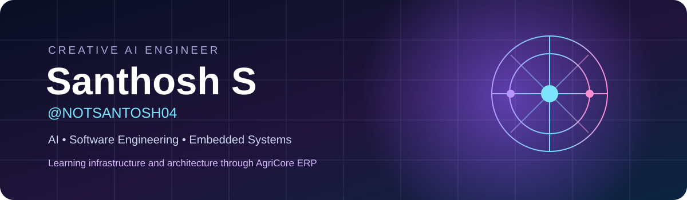

  
   
  
    
  
  
  

## ✨ About me

I'm **Santhosh S**, a B.Tech student in **Computer Science & Engineering (AI)** at **Amrita School of Engineering, Bengaluru**. I enjoy building end-to-end systems, from sensor data and deep learning prototypes to software engineering and developer tooling.

- 🔭 Currently exploring **infrastructure, CI/CD, testing, integrations and offline workflows** through **AgriCore ERP**
- 🧠 Interested in **AI/ML, computer vision, embedded systems and software architecture**
- ⚡ I like to prototype quickly, validate ideas and understand *why* engineering decisions work

## 🚜 Currently learning & building: AgriCore ERP

**AgriCore** is an agriculture ERP and farm intelligence platform designed to connect farm operations, procurement, inventory, finance, harvest and traceability.

My areas of work and learning include **developer infrastructure, CI/CD pipelines, background workers, external integrations, automated testing and mobile/offline workflows**. I'm developing a deeper understanding of how these systems fit together in a production-oriented architecture.

> Engineering focus, not a claim that every AgriCore feature is already deployed or complete.

## 🛠️ Skills & tools

**Languages:** Python · C · Java · SQL

**AI and data:** TensorFlow · Keras · scikit-learn · Pandas · NumPy · OpenCV · Computer Vision

**Embedded and IoT:** ESP32 · Arduino · Sensors · Blynk IoT

**Development:** Git · Linux · VS Code · AWS fundamentals · Docker (familiar)

**Currently exploring with AgriCore:** TypeScript · Next.js · PostgreSQL/PostGIS · GitHub Actions · React Native / Expo

## 🚀 Selected projects

| Project | What I worked on |
|:--|:--|
| **🚗 Self-Driving Car (Simulated)** | Autonomous driving simulation using **Webots, Keras, OpenCV and deep convolutional neural networks**, exploring lane following and obstacle awareness. |
| **👟 IoT Smart Shoe (ESP32)** | Prototype streaming accelerometer and force-sensor readings to cloud-based visualization using **ESP32 and Blynk**. |
| **🗣️ Real-time Pronunciation & Language Learning** | Deep learning-based pronunciation assistance and feedback; connected to co-authored **ICECCC 2025** research. |
| **🚜 AgriCore ERP** | Current software engineering and architecture learning, particularly **CI/CD, infrastructure, workers, integrations, mobile and testing**. |

## 📖 Publications & research

- **Real-Time Pronunciation and Language Learning Assistance Using Deep Learning** — ICECCC 2025
- **Blockchain-Based Secure Voting System: A Transparent and Tamper-Proof Approach** — ICRDICCT 2025

*Publication URLs can be added once verified.*

## 🎓 Education & achievements

**B.Tech, Computer Science & Engineering (AI)** — Amrita School of Engineering, Bengaluru (2022–Present in original profile; CGPA 7.9 as listed there)

**Pre-University:** Narayana PU College (2020–2022; 84%)

**High School:** New Baldwin International School (2017–2020; 74%)

**Certifications and participation:** The Complete MySQL Bootcamp (July 2025) · AWS Academy: Introduction to Cloud (November 2024) · Hackathons, workshops and VR/embedded sessions

## 📊 GitHub activity

  
  
   
  

### 🐍 Contribution animation

  

The snake animation requires the GitHub Actions workflow and the generated output branch; it will not display until that workflow runs successfully after merge. External stat images also depend on third-party service availability.

  <strong>🤝 Open to internships, research collaborations, and product-focused projects</strong>
    
  <a href="mailto:santosh.s04088@gmail.com">Email</a> · <a href="https://linkedin.com/in/-santhoshs-">LinkedIn</a> · <a href="https://github.com/NOTSANTOSH04">GitHub</a>
    
  Curiosity → Prototyping → Engineering → Learning

